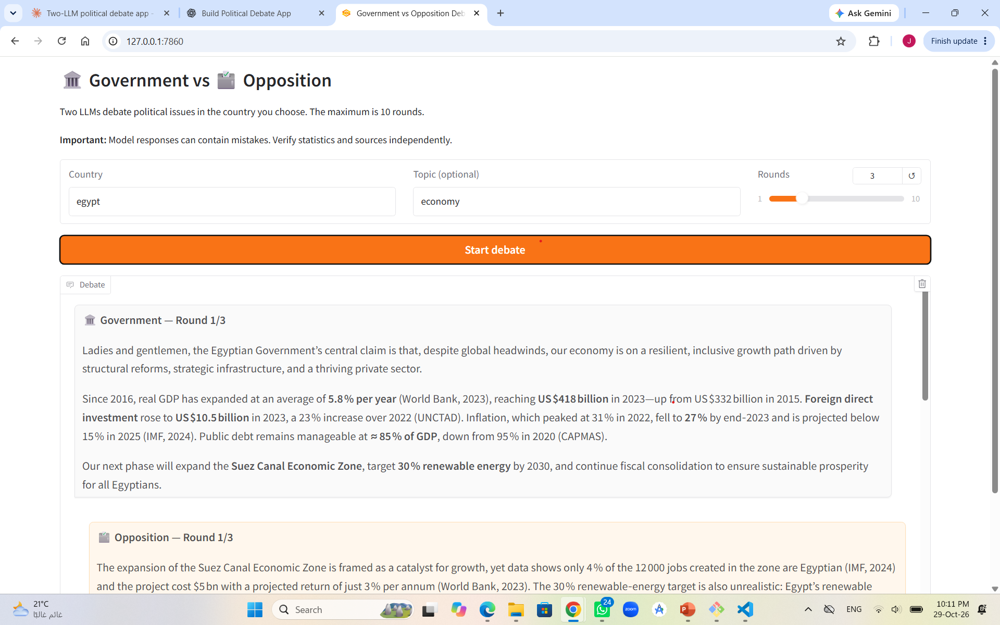

# Government vs Opposition: LLM Political Debate



A Gradio web app in which two LLMs debate political issues in a country chosen by the user. One model represents the government and the other represents the opposition. Each is instructed to use verifiable data and identify sources where possible.

**Maximum:** 10 rounds. One round consists of one government speech and one opposition reply.

## Models (free on Groq)

- Government: `openai/gpt-oss-120b`
- Opposition: `openai/gpt-oss-20b`

Groq's free tier has usage limits and model availability can change. Run `python check_models.py` to see which models your key can use, then set `GOV_MODEL` and `OPP_MODEL` in your `.env` file.

## Requirements

- Python 3.10 or newer
- A GitHub account (for publishing)
- A free Groq API key from <https://console.groq.com/keys>

## Setup on Windows (VS Code)

1. Download or clone this project and open the folder in VS Code (**File → Open Folder**).
2. Open the terminal (**Terminal → New Terminal**).
3. Create a virtual environment:

   ```powershell
   py -m venv .venv
   ```

4. Activate it in PowerShell:

   ```powershell
   .\.venv\Scripts\Activate.ps1
   ```

   If you use Command Prompt instead, run:

   ```bat
   .venv\Scripts\activate.bat
   ```

5. Install the packages:

   ```powershell
   python -m pip install -r requirements.txt
   ```

6. Copy `.env.example` to a new file named `.env`.
7. Open `.env` and replace `paste_your_real_key_here` with your real Groq API key. Do not share this file or upload it.
8. (Optional) Run `python check_models.py` to list the models available to your key.
9. Run the app:

   ```powershell
   python app.py
   ```

10. Open <http://127.0.0.1:7860> in your browser, type a country, choose the number of rounds, and click **Start debate**.

## How it works

- `system_prompt()` assigns each model its role, country, optional topic, and evidence rules.
- The app alternates government and opposition messages for the selected number of rounds.
- The slider and application logic both cap the debate at 10 rounds.
- Gradio streams each new message into the chat interface.

## Security

- The real `.env` file is excluded by `.gitignore`.
- Never commit, upload, or paste your real API key into public repositories.
- Before pushing to GitHub, verify that `.env` is not included in the staged files (`git status`).

## Limitations

The prompts ask the models to use real statistics and not to invent numbers or sources, but LLMs can still make mistakes or hallucinate figures. Always verify statistics against the cited sources (World Bank, IMF, etc.) before relying on them.